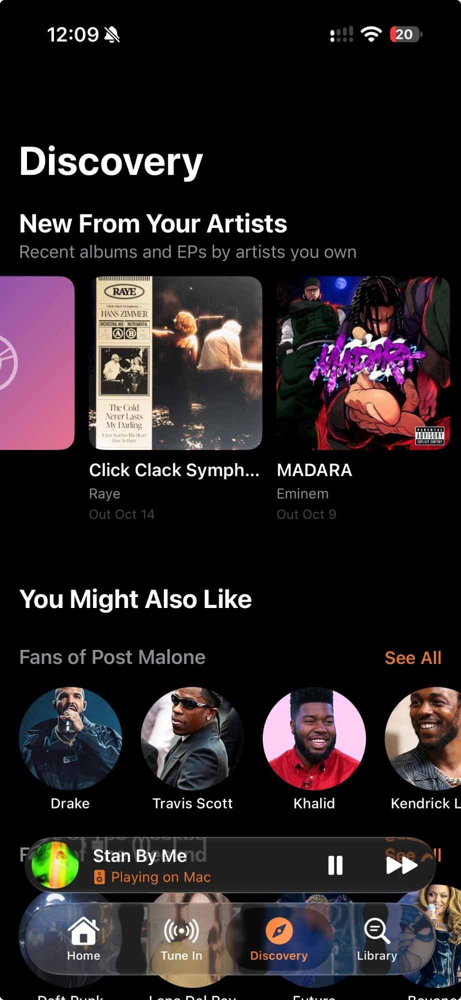
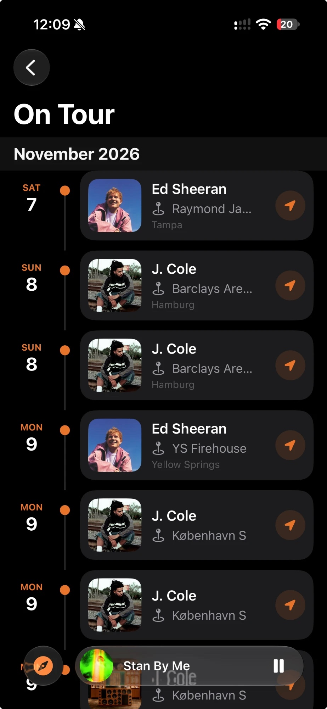
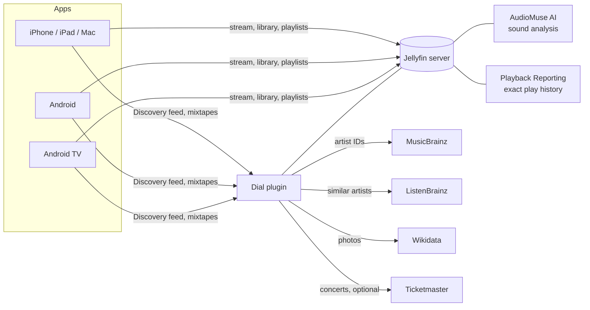

  

<h1 align="center">Dial</h1>

  <b>A music player for people who know their music.</b> 
  Your own library, from your own Jellyfin server, in an Apple&nbsp;Music style, with a DJ that talks like a radio host, mixtapes made from how <i>you</i> listen, and a Discovery page built only from the artists you already own, on iPhone, iPad, Mac, Android and Android&nbsp;TV.

  
  
  
  
  

  
  
  

---

## Get Dial

  
  
  

| Platform | Where |
|---|---|
| Android phone | [Dial for Android 0.1](https://github.com/nodescraper/dial/releases/tag/android-v0.1) |
| Android TV | [Dial for Android TV 0.1](https://github.com/nodescraper/dial/releases/tag/tv-v0.1) (all releases are under [Releases](https://github.com/nodescraper/dial/releases)) |
| iPhone, iPad and Mac | [Join the TestFlight beta](https://testflight.apple.com/join/1rFhUGK6) |
| Jellyfin server plugin | Build it from [`Plugin/`](Plugin), see [the plugin guide](docs/PLUGIN.md) |

## Why Dial

Streaming services are built to sell you *more* music. If you have spent years collecting, buying and tagging your own library, you want something different: a player that makes that library feel alive.

- **Nothing to discover that you did not choose.** Discovery follows the artists you own: their new releases, upcoming releases with a calendar, who their fans also play, and when they are on tour near you. Follow an artist and get a notification on release day.
- **Mixtapes from your own listening.** Three Daily Mixes (each a different kind of music, many artists in each, built from your whole library and from who you play together), On Repeat, Rewind, Deep Cuts and a Time Capsule, refreshed every day and the same on every device.
- **A DJ with taste.** Marlo holds one vibe for a few songs, then drifts to a neighbouring one. It knows your stats, introduces songs like a radio host, and lets the next song in only for the last seconds of a long line.
- **Your server, your data.** Everything plays from Jellyfin. Nothing about your listening leaves your network, except the artist names and IDs that Discovery looks up (see [Privacy](docs/PLUGIN.md#privacy)).

## What is in it

| | |
|---|---|
| **Library** | Artists, albums, songs, genres, decades, favourites, playlists you can rename and reorder, an A to Z index, downloads for offline. |
| **Search** | Forgiving (typos, accents, word order), results as shelves of covers, and *Beyond Your Library*: artists, albums and songs you do not have, with the same artist page as the ones you own. |
| **Player** | Full-screen player with synced lyrics, queue, crossfade, volume leveling, sleep timer, AirPlay, lock screen controls, long titles that scroll, a quiet tag for the mix or station that is playing, and a swipe (or X on Mac) to close it. It picks up the last song after a restart. |
| **Radio (Tune In)** | Your Mix, Favorites Mix, *Your Sound* (songs that match what you play most, with AudioMuse), mood stations, genre and decade stations, Christmas and seasonal live radio, thousands of live stations including Lofi Girl. Pull down to refresh. |
| **Marlo, the DJ** | Pick a vibe with a tap. A getting-ready screen shows what it is doing; it knows your listening stats, speaks long lines on their own and changes direction fast. Apple only. |
| **Mixtapes** | Made on your server once a day from your play counts, favourites and history. Forgotten songs come back first. |
| **Discovery** | A hero of the biggest news, new releases, a release calendar, upcoming releases, *You Might Also Like*, and **Following**: follow an artist and get a notification the day they release, with a link to Spotify. |
| **Artist pages** | Popular (what the world plays, from ListenBrainz), your top songs, the discography, similar artists, Follow. |
| **Connect** | Start music on one of your devices and play it on another. A device that went quiet is let go, and pressing play takes over from it. |
| **Apps** | iPhone, iPad and Mac (Catalyst) in `Dial/`; [Android](Android) and [Android TV](AndroidTV) in their own folders, with the same Discovery, search, mixtapes, follow and connect. |

  
  &nbsp;
  

## How it fits together

The **Dial plugin** is optional but is what powers Discovery and the mixtapes. It builds them once a day on your server, so every device shows the same thing instantly. Without it, those two parts are simply hidden and everything else works. See [docs/PLUGIN.md](docs/PLUGIN.md) and [docs/ARCHITECTURE.md](docs/ARCHITECTURE.md).

## Quick start

1. **Have a Jellyfin server with music in it.** New to this? Start with [docs/SERVER-SETUP.md](docs/SERVER-SETUP.md). Your library needs good tags: see [Digitising your music](docs/DIGITISING.md).
2. **Install the helpers you want** (all optional, each unlocks something):
   | Jellyfin plugin | What it gives Dial |
   |---|---|
   | **MusicBrainz** metadata (built in) | The artist IDs Discovery depends on |
   | **Playback Reporting** | The *On Repeat* mixtape and exact play history |
   | **AudioMuse AI** | Mood mixtapes, sound search, Marlo's vibes |
   | **LRCLIB Lyrics** | Synced lyrics for songs that have none |
   | **Dial** (this repo, `Plugin/`) | Discovery and the made-for-you mixtapes |
3. **Install the Dial plugin:** build it with `dotnet build -c Release Plugin` and copy the DLL into your server's plugins folder. Step by step in [docs/PLUGIN.md](docs/PLUGIN.md).
4. **Build the app:** [docs/BUILD.md](docs/BUILD.md) covers iPhone, iPad and Mac (XcodeGen + Xcode), Android and Android TV.
5. Open the app, sign in with your Jellyfin address and account (or Quick Connect), and play something.

## Digitise your own music

Dial is for music you own. Ripping your CDs, capturing vinyl and tagging it properly is what makes everything above work well. There is a full guide: **[docs/DIGITISING.md](docs/DIGITISING.md)** (CDs, vinyl, cassettes, DRM-free stores, tagging with MusicBrainz Picard, folder layout, formats, ReplayGain, backups).

The short version:

- Rip CDs to **FLAC** with a verified ripper (XLD, Exact Audio Copy, whipper).
- Tag everything with **MusicBrainz Picard** so every file carries its MusicBrainz IDs.
- Keep one folder per album: `Artist/Album (Year)/01 Title.flac`, with `cover.jpg`.
- Back it up (3 copies, 2 kinds of media, 1 elsewhere) before you celebrate.

## Tips

- **Discovery is empty?** Make sure the MusicBrainz metadata provider is enabled for your music library and your artists have MusicBrainz IDs, then run *Refresh Dial Discovery* in the Jellyfin dashboard (Scheduled Tasks).
- **Mixtapes feel samey?** They rest what you heard in the last three days, favour songs you have not played in a while and count songs you keep skipping for less. The three Daily Mixes group your artists by what you play together, so the more you listen the better they split. Press **Regenerate mixtapes** on the plugin's settings page to rebuild them now.
- **Marlo does not drift?** It needs AudioMuse's clustering run at least once (the `…_automatic` playlists in Jellyfin are its vibes).
- **Concerts:** get a free key at [developer.ticketmaster.com](https://developer.ticketmaster.com/), then add it and a country code on the Dial plugin's settings page.
- **Away from home:** put Jellyfin behind a reverse proxy with HTTPS, or use a private network such as Tailscale. Do not expose it bare.

## Repository layout

| Path | What |
|---|---|
| `Dial/` | The iOS, iPadOS and Mac (Catalyst) app, SwiftUI |
| `Plugin/` | The Jellyfin server plugin that makes Discovery and the mixtapes (C#, .NET 10) |
| `Android/` | The Android app (Kotlin, Jetpack Compose) |
| `AndroidTV/` | The Android TV app, sharing the Android data layer |
| `Design/`, `Website/` | App icon sources and the project website |
| `docs/` | Guides: [server](docs/SERVER-SETUP.md), [plugin](docs/PLUGIN.md), [digitising](docs/DIGITISING.md), [build](docs/BUILD.md), [architecture](docs/ARCHITECTURE.md) |

## Status

Dial is a personal project that is growing into something shareable. It is used daily against a real library, but expect rough edges, and note that it targets **Jellyfin 12** (the plugin is built against 12.x). Issues and ideas are welcome: see [CONTRIBUTING.md](CONTRIBUTING.md).

## Credits

Dial stands on open data and open software: [Jellyfin](https://jellyfin.org), [AudioMuse-AI](https://github.com/NeptuneHub/AudioMuse-AI), [MusicBrainz](https://musicbrainz.org), [ListenBrainz](https://listenbrainz.org), [Cover Art Archive](https://coverartarchive.org), [Wikidata and Wikimedia Commons](https://www.wikidata.org), [radio-browser.info](https://www.radio-browser.info), [LRCLIB](https://lrclib.net), and Ticketmaster's Discovery API for concerts.

## License

[PolyForm Noncommercial 1.0.0](LICENSE): free to read, build and use for yourself, not to sell. Album artwork shown in screenshots belongs to its owners.

## What is where

| Folder | What |
|---|---|
| `Dial/`, `DialWidget/`, `Shared/`, `project.yml` | iPhone, iPad and Mac app (and the Home Screen widget) |
| `Android/` | Android phone app (and Android Auto) |
| `AndroidTV/` | Android TV app (`DialTV`) and the shared Android code it builds on (`DialAndroid`) |
| `Plugin/` | The Jellyfin server plugin (Discovery and mixtapes) |
| `Website/` | The plain link page at dialplayer.site (published from the `website` branch) |
| `docs/` | Guides: build, server setup, plugin, store, CarPlay |
