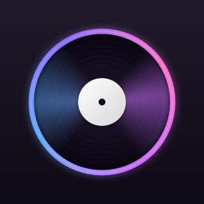
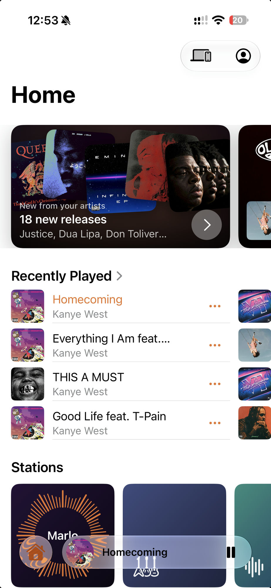
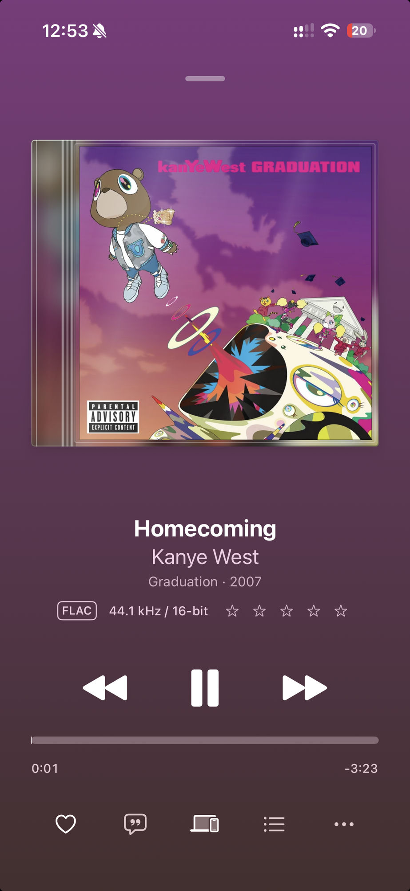
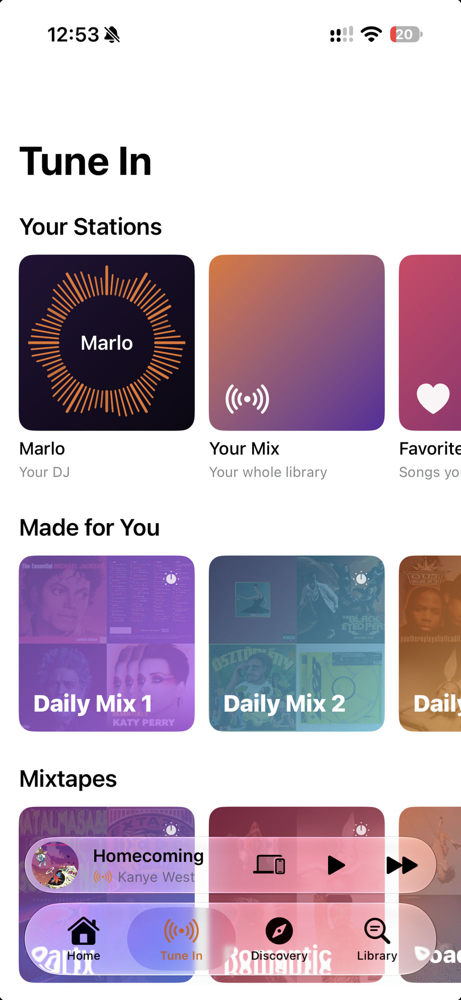
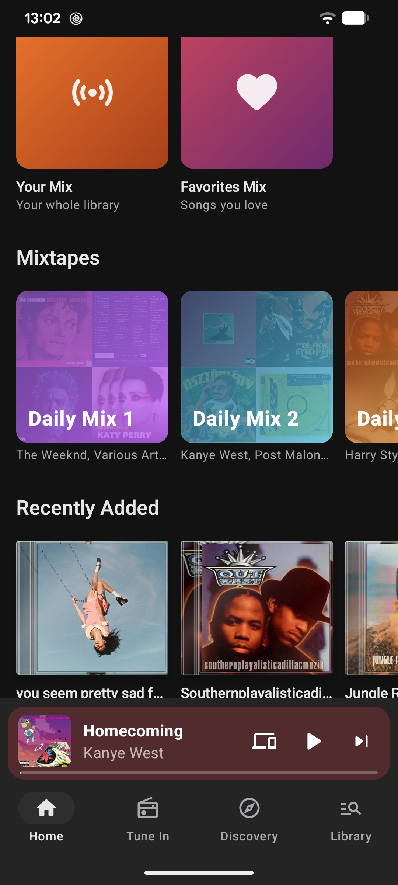
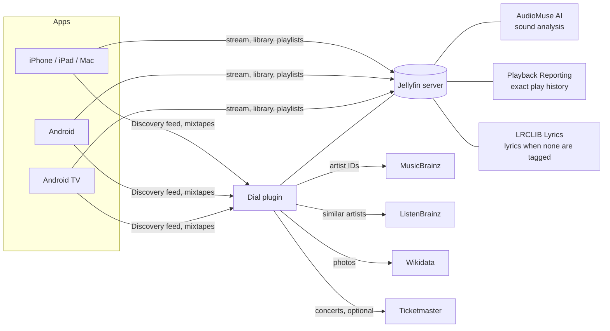

  

<h1 align="center">Dial</h1>

  <b>A music player for people who already own their music.</b> 
  Plays your library from your own Jellyfin server, with a radio that drifts by sound, lyrics, a Discovery page built from the artists you own, and playback shared across your devices. iPhone, iPad, Mac, Android and Android&nbsp;TV.

  
  
  
  
  

  
  
  
  

---

## Get Dial

| Platform | How to get it |
|---|---|
| iPhone, iPad and Mac | [Join the TestFlight beta](https://testflight.apple.com/join/1rFhUGK6) |
| Android phone | Build from [`Android/`](Android), or install the APK from [Releases](https://github.com/nodescraper/dial/releases) |
| Android TV | Build from [`AndroidTV/DialTV`](AndroidTV/DialTV), or install the APK from [Releases](https://github.com/nodescraper/dial/releases) |
| Jellyfin server plugin | Build from [`Plugin/`](Plugin). See [the plugin guide](docs/PLUGIN.md) |

## Key features

### Radio that listens to the sound

- **Marlo, the DJ.** Pick a vibe with one tap. Marlo plays a few songs from one mood, then drifts to a neighbouring one, and speaks a short line when it changes direction. It knows your listening stats and works from your library.
- **Your Sound.** Songs that match the sound of what you play most, using the sound analysis from AudioMuse.
- **Radio from any song.** Tap one song outside an album and it plays first, followed by the songs that sound closest to it, in a random order that keeps the closest ones near the front. Albums, playlists and mixtapes keep their own order.
- **Your Mix, Favorites Mix, mood, genre and decade stations**, plus thousands of live stations, Christmas and seasonal live radio, and Lofi Girl.

### Discovery built from what you own

- **New from your artists**: the newest releases from the artists in your library.
- **Calendar and Following.** Upcoming releases with dates. Follow an artist and get a notification on release day.
- **On tour.** A timeline of concerts near you, by artists you own (Ticketmaster, optional).
- **Beyond your library.** Search finds artists, albums and songs you do not have yet, and they can go on a wishlist that your server keeps for every device.

### Mixtapes from how you listen

- Three Daily Mixes, On Repeat, Rewind, Deep Cuts, a Time Capsule, and mood, decade and genre mixtapes. Made once a day on your server, so every device shows the same thing.
- Songs you heard in the last three days rest. Forgotten songs come back first.

### Lyrics

- Synced lyrics that follow the song. Tap a line to jump to it.
- Lyrics come from your Jellyfin server first. For songs without any, LRCLIB fills in.

### Player

- Full-screen player with an equalizer (ten bands, presets such as Bass Boost, applied to everything including live radio), volume leveling, a sleep timer, AirPlay and lock screen controls.
- A queue you can reorder, shuffle and repeat.
- Dial remembers your last song and picks it up after a restart.

### Your stats

- **Your Stats**: your top artists, songs and listening time, with a card for your number one artist.
- **Library Stats**: your library in numbers. Size, formats and bitrates, lossless share, decades and genres, never-played songs, and missing covers or tags.
- **Export Library**: artists, albums and tracks as three CSV files in one zip.

### Playback across your devices

- **Connect** shows your devices. Start a song on one and continue it on another, and pressing play takes over from a device that went quiet.

### Android TV

- Built for the couch: a remote-friendly interface with a Home screen, your Library, Tune In radio, search, album and artist pages, and the full player.
- **Dial as a screensaver.** While music plays and the TV idles, the screen shows the cover, title and artist.
- The same wishlist and stats as the phone, read-only where a screen is better for browsing.
- The same radio from any song as the phone.
- Install from [`AndroidTV/DialTV`](AndroidTV/DialTV) (see [docs/BUILD.md](docs/BUILD.md)).

### Design

- Album covers appear in a CD jewel case, with the spine and the plastic reflections, and in a flat square where a case would not fit (Discovery, Tune In, the mixtapes).
- Apple-style on iPhone, iPad and Mac. Material on Android, with the same layout and the same colours from each album's artwork.

## How it fits together

The **Dial plugin** is optional. It powers Discovery and the mixtapes, and builds them once a day on your server. Without it, those parts are hidden and everything else still works. See [docs/PLUGIN.md](docs/PLUGIN.md) and [docs/ARCHITECTURE.md](docs/ARCHITECTURE.md).

## Quick start

1. **Have a Jellyfin server with music in it.** New to this? Start with [docs/SERVER-SETUP.md](docs/SERVER-SETUP.md).
2. **Install the helpers you want.** Each one unlocks something:

   | Jellyfin plugin | What it gives Dial |
   |---|---|
   | **MusicBrainz** metadata (built in) | The artist IDs Discovery depends on |
   | **Playback Reporting** | The On Repeat mixtape and exact play history |
   | **AudioMuse AI** | Your Sound, sound search, and Marlo's vibes |
   | **LRCLIB Lyrics** | Synced lyrics for songs that have none |
   | **Dial** (this repo, `Plugin/`) | Discovery and the made-for-you mixtapes |

3. **Install the Dial plugin.** In Jellyfin, go to **Dashboard → Plugins → Repositories**, add `https://raw.githubusercontent.com/nodescraper/dial/main/manifest.json`, then install **Dial** from the **Catalog** and restart. The steps, and the manual build, are in [docs/PLUGIN.md](docs/PLUGIN.md).
4. **Build the app.** [docs/BUILD.md](docs/BUILD.md) covers iPhone, iPad and Mac (XcodeGen and Xcode), Android and Android TV.
5. Open the app, sign in with your Jellyfin address and account (or Quick Connect), and play something.

## Tips

- **Discovery is empty?** Turn on the MusicBrainz metadata provider for your music library, make sure your artists have MusicBrainz IDs, then run *Refresh Dial Discovery* in the Jellyfin dashboard (Scheduled Tasks).
- **Mixtapes feel samey?** They rest what you heard in the last three days and favour songs you have not played in a while. Press **Regenerate mixtapes** on the plugin's settings page to rebuild them now.
- **Marlo does not drift?** It needs AudioMuse's clustering to run at least once. The `…_automatic` playlists in Jellyfin are its vibes.
- **Concerts:** get a free key at [developer.ticketmaster.com](https://developer.ticketmaster.com/), then add it and a country code on the Dial plugin's settings page.
- **Away from home:** put Jellyfin behind a reverse proxy with HTTPS, or use a private network such as Tailscale. Do not expose it bare.

## Repository layout

| Path | What |
|---|---|
| `Dial/` | The iPhone, iPad and Mac (Catalyst) app, SwiftUI |
| `Android/` | The Android phone app (Kotlin, Jetpack Compose) |
| `AndroidTV/` | The Android TV app (`DialTV`) and the shared Android code it builds on (`DialAndroid`) |
| `Plugin/` | The Jellyfin server plugin for Discovery and the mixtapes (C#, .NET) |
| `Design/`, `Website/` | App icon sources and the project website |
| `docs/` | Guides: [server](docs/SERVER-SETUP.md), [plugin](docs/PLUGIN.md), [build](docs/BUILD.md), [architecture](docs/ARCHITECTURE.md) |

## Status

Dial is a personal project that is growing into something shareable. It runs daily against a real library, but expect rough edges. It targets **Jellyfin 12**. Issues and ideas are welcome: see [CONTRIBUTING.md](CONTRIBUTING.md).

## Credits

Dial stands on open data and open software: [Jellyfin](https://jellyfin.org), [AudioMuse-AI](https://github.com/NeptuneHub/AudioMuse-AI), [MusicBrainz](https://musicbrainz.org), [ListenBrainz](https://listenbrainz.org), [Cover Art Archive](https://coverartarchive.org), [Wikidata and Wikimedia Commons](https://www.wikidata.org), [radio-browser.info](https://www.radio-browser.info), [LRCLIB](https://lrclib.net), and Ticketmaster's Discovery API for concerts.

## License

[PolyForm Noncommercial 1.0.0](LICENSE): free to read, build and use for yourself, not to sell. Album artwork shown in screenshots belongs to its owners.
