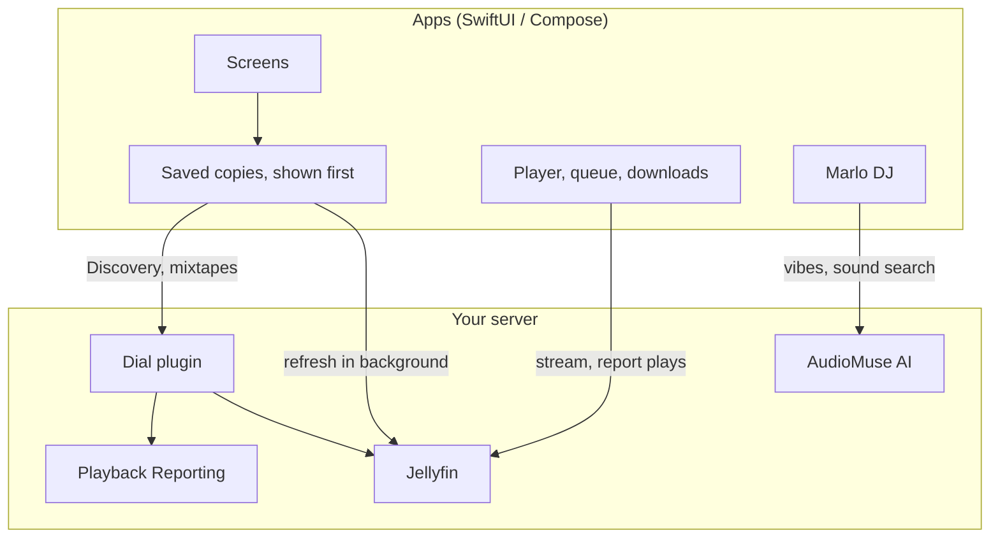

# Architecture

## The pieces

## Principles

1. **Saved first, refresh quietly.** Every screen shows what it had last time at once and updates in the background. Rows that are still arriving show a skeleton, never an empty placeholder. A row with nothing to show is left out.
2. **Optional helpers, honest UI.** Anything that needs a server add-on is hidden when the add-on is missing. The Server Add-ons screen says what each one gives you.
3. **Use Jellyfin's own data.** Play counts, favourites, genres, years and playlists come from Jellyfin. Dial adds on top (AudioMuse, MusicBrainz, ListenBrainz), and never needs a separate account.
4. **One source of truth for shared things.** Discovery and mixtapes are made once, on the server, so devices agree.

## iOS, iPadOS, Mac

- `Dial/App`: startup, sign-in, navigation (`Route`), design tokens (`Theme.swift`).
- `Dial/Services`: the Jellyfin client, player, downloads, AudioMuse, the DJ (`DJPlanner`, `DJCommentary`), snapshots and freshness caching, public music data.
- `Dial/Views`: every screen; `Components.swift` holds the shared pieces (rows, tiles, shelves, load states).
- The Mac is the same app built with Mac Catalyst, with a sidebar and a bottom player bar.

### Marlo, the DJ

Marlo plays blocks of songs. A block stays in one **vibe** (an AudioMuse cluster); every second block it moves to a **neighbouring** vibe: the cluster that holds the most songs that sound like the current one. At the turn it says one short line, written by the on-device model from true facts (the next artist) or from a hand-written fallback. Tapping a vibe tile jumps to it, and the set drifts on from there.

### Caching

`Snapshots` keeps decoded values in memory and on disk; `Freshness` marks when something was last refreshed. Saved values are read with tolerant decoders so a new field never throws away a saved page.

## Android and Android TV

Separate branches. The phone app is Kotlin and Jetpack Compose; the TV app has its own screens and shares the phone's data layer. They read the same plugin endpoints as the Apple apps.

## The plugin

See [PLUGIN.md](PLUGIN.md). Two scheduled tasks build per-user files; endpoints serve them; the apps never talk to MusicBrainz or Ticketmaster for those feeds.
